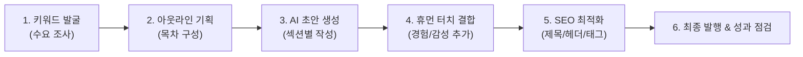

# ⚙️ AI 활용 블로그 작성 6단계 표준 워크플로우

과거에는 글 하나를 쓰려면 자료 조사부터 타이핑, 교정까지 3~4시간이 걸렸습니다.  
AI(Gemini, ChatGPT, Claude)를 비서로 활용하면 **1시간 이내에 완성도 높은 고품질 포스팅 1편을 제작**할 수 있습니다.

---

## 🔄 6단계 프로세스 한눈에 보기

---

## 단계별 세부 실천 가이드

### 1단계: 황금 키워드 발굴 (수요 조사)
- **목표**: 사람들이 실제로 많이 검색하지만, 경쟁 블로그가 너무 세지 않은 '빈틈 키워드' 찾기.
- **활용 도구**: 네이버 데이터랩, 블랙키위(BlackKiwi), 구글 트렌드, 키워드마스터.
- **AI 활용 팁**:
  - `프롬프트`: *"50~60대 은퇴자가 '국민연금'과 관련해 네이버나 구글에 가장 자주 검색하는 질문 키워드 10가지를 검색 의도와 함께 추천해 줘."*

### 2단계: 아웃라인(목차) 기획
- **목표**: 독자가 글을 읽다가 이탈하지 않고 끝까지 스크롤하게 만드는 탄탄한 뼈대 설계.
- **구조 원칙 (도입 - 본론 - 결론)**:
  - **도입부**: 독자의 고민 공감 + 이 글을 읽으면 얻게 되는 확실한 혜택 제시.
  - **본론 (소제목 3~4개)**: 핵심 원리 → 구체적 신청 방법/주의점 → 실제 사례/수치 비교.
  - **결론 & CTA**: 3줄 요약 + 행동 유도(댓글, 공감, 공유).
- **AI 활용 팁**:
  - `프롬프트`: *"[키워드]를 주제로 블로그 글을 쓰려고 해. 검색 상위 노출에 유리하고 체류 시간을 극대화할 수 있는 H2, H3 소제목 목차를 짜줘."*

### 3단계: AI 초안 생성 (섹션별 쪼개어 작성하기)
- **주의사항**: 한 번에 "글 전체를 써줘"라고 하면 내용이 얕아지고 상투적인 문장이 나옵니다.  
  **소제목별로 나누어 구체적인 데이터를 요청**해야 깊이 있는 글이 나옵니다.
- **AI 활용 팁**:
  - `프롬프트`: *"소제목 1번인 '[소제목 내용]'에 대해 작성해 줘. 은퇴자가 쉽게 이해할 수 있도록 실제 숫자 예시와 표(테이블)를 포함해 줘."*

### 4단계: 휴먼 터치 결합 (AI 냄새 제거 & 경험담 삽입)
- **가장 중요한 단계!** AI가 쓴 글에 나의 생명력을 불어넣는 작업입니다.
- **체크 포인트**:
  1. **내 경험 한 줄 넣기**: *"제가 작년에 직접 국민연금공단에 전화해서 물어봤더니..."*
  2. **상투적 AI 말투 삭제**:
     - ❌ "현대 사회에서 ~는 필수적입니다."
     - ❌ "~에 대해 깊이 있게 알아보겠습니다."
     - ❌ "결론적으로 말씀드리면..."
     - ⭕ "저도 처음엔 참 막막했는데요, 딱 3가지만 알면 쉽더라고요."
  3. **직접 찍은 사진 또는 인증 캡처 삽입**: 구글과 네이버 모두 직접 촬영한 원본 이미지를 가장 높게 평가합니다.

### 5단계: SEO 및 가독성 최적화
- **제목 작성**: 핵심 키워드를 앞쪽에 배치하고, 숫자와 호기심을 자극하는 문구 결합.
  - (예: `국민연금 수령액 늘리기` ❌ → `국민연금 매달 30만원 더 받는 법: 제가 직접 신청해 본 후기` ⭕)
- **소제목 태그**: 마크다운에서는 `## (H2)`, `### (H3)`, 블로그 에디터에서는 '소제목' 서식 적용.
- **키워드 반복**: 본문 전체에 핵심 키워드가 4~6회 자연스럽게 녹아들도록 점검.

### 6단계: 최종 발행 & 성과 점검
- **발행 후 24시간 뒤 점검**: 네이버/구글 검색창에 제목을 검색하여 정상 노출되는지 확인.
- **인기 글 재가공**: 유입이 많은 효자 글은 3~6개월마다 최신 정보로 업데이트하여 1등 순위 유지.
